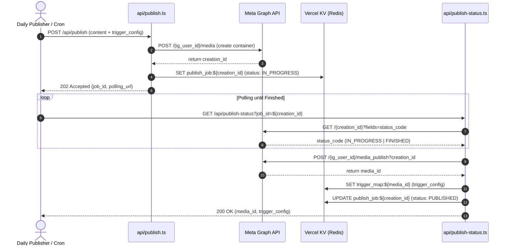

# neuralpulse.hq - Architecture Specification

**System Role**: Principal AI Infrastructure Architecture  
**Target Environment**: Vercel Serverless (Node.js 20/22 runtime)  
**State Store**: Vercel KV / Upstash Redis  
**Inference Engine**: Google Generative AI (`@google/generative-ai` - Gemini 2.5 Flash)  
**Social Graph**: Meta / Instagram Graph API (v21.0)

---

## 1. Key Value (KV) Schema Logic

All keys are namespaced to avoid collision and enforce deterministic TTL lifecycles:

| Key Pattern | Data Type | TTL | Description |
| :--- | :--- | :--- | :--- |
| `trigger_map:${media_id}` | `TriggerConfig` JSON | 90 days (`7,776,000s`) | Post-specific trigger keyword and automated response mapping. |
| `publish_job:${creation_id}` | `PublishJobRecord` JSON | 7 days (`604,800s`) | Asynchronous video rendering ticket and publication status. |
| `dm_history:${user_id}` | `ChatMessage[]` JSON | 30 days (`2,592,000s`) | Sliding conversational memory window capped at 5 messages. |
| `comment_processed:${comment_id}` | `boolean` | 14 days (`1,209,600s`) | Idempotency guard preventing duplicate comment replies. |
| `webhook_dedup:${event_id}` | `boolean` | 2 hours (`7,200s`) | Webhook replay and deduplication filter. |

---

## 2. Asynchronous Video Rendering & Publishing State Machine

Meta's Graph API processes video uploads and Reels asynchronously through a container creation step followed by a rendering pipeline. Because serverless functions on Vercel have execution timeouts (typically 10s-15s on standard tiers and 60s on Pro), holding open an HTTP connection while waiting for Meta's rendering to complete is an anti-pattern.



---

## 3. Dynamic Comment Engine Pipeline

```mermaid
flowchart TD
    Start([Incoming Webhook: Comment]) --> SignatureCheck{Valid HMAC SHA-256?}
    SignatureCheck -- No --> Reject403[Reject 403 Forbidden]
    SignatureCheck -- Yes --> DedupCheck{Already Processed?}
    DedupCheck -- Yes --> SkipDup[Skip Duplicate Event]
    DedupCheck -- No --> BotCheck{Is Commenter Bot Account?}
    BotCheck -- Yes --> SkipSelf[Ignore Self Comment]
    BotCheck -- No --> Lookup[Query KV: trigger_map:media_id]

    Lookup --> TriggerFound{Trigger Config Mapped?}
    TriggerFound -- Yes --> MatchWord{Comment contains trigger word?}
    
    MatchWord -- Yes --> ExecMatch[Parallel Dispatch]
    ExecMatch --> ReplyComment[POST /{comment_id}/replies]
    ExecMatch --> SendDM[POST /{ig_user_id}/messages Private Reply]

    TriggerFound -- No --> LLMFallback[Route to Gemini Founder Fallback]
    MatchWord -- No --> LLMFallback

    LLMFallback --> GenReply[Gemini: Generate 1-sentence technical reply]
    GenReply --> PostLLMReply[POST /{comment_id}/replies]
```

---

## 4. Intelligent DM Engine with Sliding Conversational Memory

```mermaid
flowchart TD
    DMStart([Incoming Webhook: Message]) --> EchoCheck{Is Echo or Bot?}
    EchoCheck -- Yes --> SkipEcho[Ignore Echo/Self Message]
    EchoCheck -- No --> FetchMemory[Retrieve KV: dm_history:user_id]

    FetchMemory --> BuildContext[Construct Gemini Chat Session]
    BuildContext --> SystemPrompt[Inject Founder System Prompt: sharp, technical, qualify intent]
    SystemPrompt --> ModelGen[Gemini 2.5 Flash Generation]

    ModelGen --> SendResponse[POST /{ig_user_id}/messages to User]
    SendResponse --> UpdateMemory[Slide Memory: Append Turn & Trim to 5 Messages]
    UpdateMemory --> SaveKV[SET KV: dm_history:user_id with 30-day TTL]
```

---

## 5. Resilience & Rate-Limiting Design

- **Exponential Backoff with Full Jitter**:
  ```
  sleep = Math.random() * Math.min(MAX_DELAY_MS, BASE_DELAY_MS * 2^attempt)
  ```
  Prevents thundering herd problems on Meta Graph API rate-limit spikes.
- **Retry Predicate**:
  Interprets both HTTP transport errors (`429`, `500`, `502`, `503`, `504`) and Meta-specific application rate-limiting error codes (`4`, `17`, `32`, `613`).
- **Idempotent Webhook Receipts**:
  Webhook responses always emit `200 OK` once signature validation passes to ensure Meta's webhook engine does not mark the endpoint unhealthy during intermittent external service latencies.
